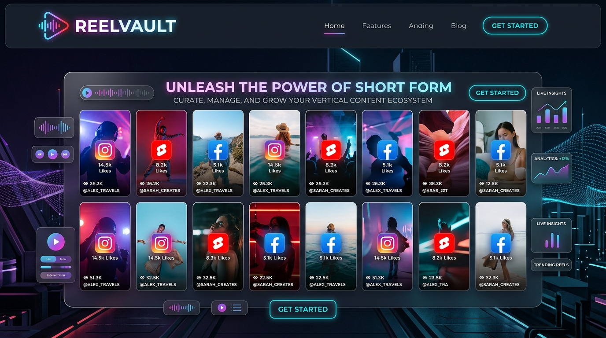
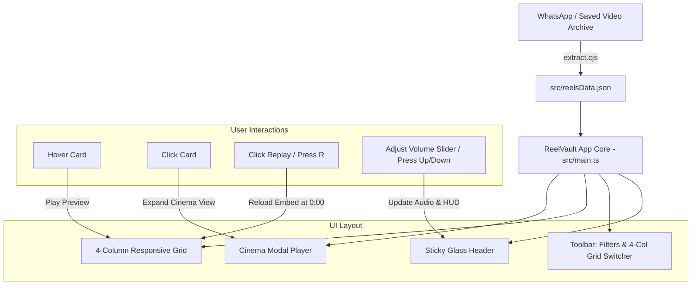

<div align="center">

# 🎬 ReelVault

### *A Sleek, High-Performance 4-Column Personal Reels & Shorts Feed*

[](https://vitejs.dev/)
[](https://www.typescriptlang.org/)
[](https://developer.mozilla.org/en-US/docs/Web/CSS)
[](https://developer.mozilla.org/en-US/docs/Web/HTML)
[](LICENSE)

<br/>



<br/>

<p align="center">
  <b>ReelVault</b> is a futuristic, distraction-free vertical content hub that unifies <b>Instagram Reels</b>, <b>Facebook Reels</b>, and <b>YouTube Shorts</b> into a unified 4-column interactive feed with instant hover preview, cinema view, and YouTube-style volume management.
</p>

[Explore Features](#-key-features) • [Quickstart](#-quickstart) • [Shortcuts](#-keyboard-shortcuts) • [Architecture](#-architecture)

</div>

---

## ⚡ Highlights at a Glance

<table>
  <tr>
    <td width="50%">
      <h3>📺 4-Column Responsive Layout</h3>
      <p>Organizes hundreds of short-form videos side-by-side in a responsive 4-column desktop feed, with dynamic column toggles (2, 3, 4, 5 columns).</p>
    </td>
    <td width="50%">
      <h3>▶️ Instant Hover-to-Play</h3>
      <p>Simply hover your mouse cursor over any reel to activate the live player preview and hear audio immediately without leaving the page.</p>
    </td>
  </tr>
  <tr>
    <td width="50%">
      <h3>🔄 Instant Replay (No More "Watch on IG")</h3>
      <p>Bypasses Instagram's frustrating "Watch again on Instagram" end screen with a dedicated one-click instant reload mechanism (hotkey <code>R</code>).</p>
    </td>
    <td width="50%">
      <h3>🔊 YouTube-Style Volume System</h3>
      <p>Seamless volume control with interactive slider bar, mute/unmute toggle, on-screen Volume HUD, and persistent <code>localStorage</code> preferences.</p>
    </td>
  </tr>
</table>

---

## ✨ Key Features

### 1. 📺 4-Column Side-by-Side Showcase (Default)
- **Signature 4-Column Feed**: View all your bookmarked reels side by side in four high-resolution vertical columns.
- **Dynamic Grid Switcher**: Effortlessly switch between **4 Columns (Default)**, **3 Columns**, **2 Columns**, or **5 Columns** with smooth CSS Grid transitions.
- **Buttery 60fps Scrolling**: Optimized with `IntersectionObserver` lazy rendering so hundreds of active videos scroll fluidly with zero browser lag.

### 2. ▶️ Hover & Click-to-Play Engine
- **Hover Activation**: Hovering over any card smoothly slides into active video preview.
- **Cinema Mode**: Clicking any card expands into a distraction-free Cinema Modal with keyboard controls and quick navigation.
- **Direct Source Links**: Every card has a quick `↗ Open` button to launch the original Instagram, Facebook, or YouTube URL in a new tab.

### 3. 🔄 Instant Replay (Solves "Watch again on Instagram")
- When Instagram reels finish, Instagram typically locks the video behind a "Watch again on Instagram" overlay.
- **ReelVault** features an **Instant Replay (↺)** button on every card and in Cinema Mode.
- Simply click **Replay** or press **`R`** to immediately restart playback from 0:00!

### 4. 🔊 YouTube-Style Volume Controller
- Styled directly after YouTube's audio control:
  - **Speaker Mute / Unmute Button** (🔊 High, 🔉 Low, 🔇 Mute)
  - **Horizontal Slider Bar** with clean white progress fill
  - **Real-Time Synchronized Indicator**: Header master volume, modal volume, and status banner stay 100% in sync.
  - **Volume HUD**: An animated on-screen HUD appears when adjusting volume via hotkeys (`↑` / `↓`).
- *Audio Compatibility*: YouTube Shorts support external 0–100% volume control via the YouTube IFrame API. For Instagram and Facebook embeds, sound can also be toggled with the speaker button inside the native player.

### 5. 🔍 Real-Time Search & Category Filters
- **Filter Tabs**:
  - 🌟 **All Reels** (320+ items)
  - 📸 **Instagram Reels**
  - 📘 **Facebook Reels & Videos**
  - 🔴 **YouTube Shorts & Videos**
  - 💖 **Favorites** (saved in `localStorage`)
- **Instant Search**: Search by Reel ID, keyword, caption, or date with instant typing results.
- **Add Custom Reel**: Paste any new Instagram, Facebook, or YouTube link to save it instantly to your personal collection.
- **Random Reel Shuffle**: Click **"Random Reel"** to discover a surprise reel from your collection.

---

## ⌨️ Keyboard Shortcuts

| Shortcut | Action | Description |
|:---:|:---|:---|
| <kbd>R</kbd> | **Instant Replay** | Reloads & replays active reel from 0:00 |
| <kbd>↑</kbd> | **Volume Up** | Increases volume by +5% |
| <kbd>↓</kbd> | **Volume Down** | Decreases volume by -5% |
| <kbd>M</kbd> | **Toggle Mute** | Mutes or restores previous volume |
| <kbd>→</kbd> | **Next Reel** | Advances to next reel in Cinema Mode |
| <kbd>←</kbd> | **Previous Reel** | Goes to previous reel in Cinema Mode |
| <kbd>Esc</kbd> | **Close Cinema** | Exits Cinema Modal |

---

## 🏗️ Architecture & Interaction Flow



---

## 🚀 Quickstart

### Prerequisites
- [Node.js](https://nodejs.org/) (v18 or higher recommended)
- `npm`

### 1. Clone the Repository
```bash
git clone https://github.com/asif496/reel-vault.git
cd reel-vault
```

### 2. Install Dependencies
```bash
npm install
```

### 3. Run Locally (Dev Server)
```bash
npm run dev
```
Open **`http://localhost:5173/`** in your browser to start exploring your collection!

### 4. Build for Production
```bash
npm run build
npm run preview
```

---

## 📁 Project Structure

```text
reel-vault/
├── docs/
│   └── banner.png             # Eye-catching hero banner graphic
├── public/
│   ├── favicon.svg            # Custom SVG favicon
│   └── icons.svg              # Vector sprite definitions
├── src/
│   ├── types.ts               # TypeScript interfaces & types
│   ├── reelsData.json         # Curated 322+ reels dataset
│   ├── style.css              # 4-column grid, glassmorphism & YouTube audio UI
│   └── main.ts                # App logic, hover-play, cinema modal, replay & volume
├── index.html                 # Main entrypoint with Google Fonts
├── package.json               # Scripts & dependencies
├── tsconfig.json              # TypeScript configuration
└── README.md                  # Project documentation
```

---

## 🎨 Design Philosophy
- **Luxury Dark Aesthetic**: Designed with deep obsidian backgrounds (`#07090e`), frosted glassmorphism, and neon brand gradients (Instagram magenta, Facebook royal blue, YouTube crimson).
- **Zero Placeholder Bloat**: Fully interactive UI with zero placeholders; every button and slider performs live operations.
- **Privacy & Local-First**: Custom additions and favorite bookmarks are persisted locally in your browser's `localStorage`.

---

<div align="center">
  <b>Built with ❤️ for fluid content curation.</b>
  <br/>
  <sub>⭐ If you find ReelVault useful, don't forget to star the repository!</sub>
</div>
